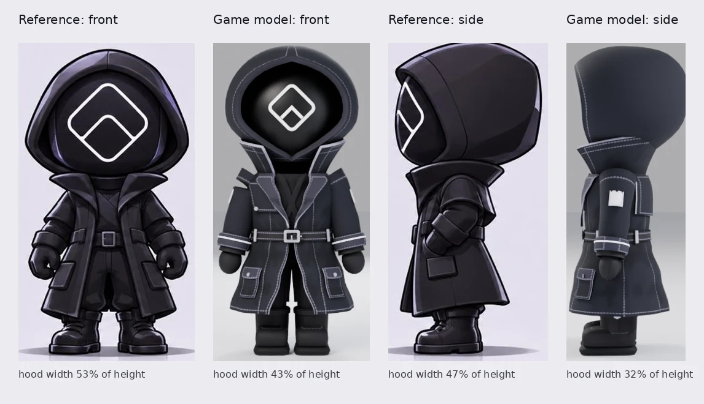

# CN TRIAL · Stage 1.5 second pass (decision 034)

Branch `claude/project-thread-rdi933`, stacked on PR #24 (Stage 01 refinement, branch `claude/project-thread-8jwd5y`).
Merge PR #24 first, then this one. Neither is merged or deployed without the owner's approval.
Only Stage 01 is touched; no other stage is created (owner answer A, 25 Nov 2026).

## Owner answers (25 Nov 2026) and what was built

| # | Owner answer | Built |
|---|---|---|
| A | Start with Stage 1. Do not touch or create another stage | All work is Stage 01 presentation and client code. No stage, rule or server change |
| B | Audio as long as it matches the game's theme; add mute/unmute in the game or settings | Synthesised Web Audio sound (no files): signals, Watcher servo and scan hum, spotted, finish, countdown, bumps, footsteps, night-yard ambience, UI clicks. Mute: speaker button in the HUD, <kbd>M</kbd>, and Settings (sound on/off and volume, remembered in the browser) |
| C | Yes (animation feel, walk-only rules), and remove the jagged or laggy feeling walking left or right | Smoothing fix below, plus a springy "feel" layer on the contestant |
| D | Maybe an Intel Mac laptop | `?perf=1` readout with a Copy report button, for running on that Mac |
| E | Yes | `deploy.yml` skips merges that only change docs, references, renders or test reports |
| F | Sure, go ahead | Side-by-side review below; no model change without approval |

## C. Why walking sideways felt jagged, and the fix

The simulation (server and client prediction) runs in fixed 30 Hz steps. The client drew the latest step directly,
so on a 60 Hz screen the contestant moved every other frame. The camera smoothed its position but aimed straight at
the stepped position, so each step swung the view. Walking forward hid it (the look target moved along the view
direction); walking left or right showed it at full strength. The facing and walk-speed animation read the stepped
motion too, so they flickered.

- `apps/web/src/game/predictor.ts`: draws the local contestant interpolated between the last two fixed steps, and
  blends a server correction out over about 0.15 s instead of snapping (corrections over 1.5 m still snap).
- `apps/web/src/game/Scene.tsx`: the camera follows one smoothed anchor and takes both its position and its look
  target from it, so it no longer rotates on each step. The controller runs before the contestants each frame, so the
  camera and the contestant always use the same position.
- Other players: snapshots arrive at 20 Hz. They are now extrapolated along their server velocity for up to 0.1 s
  before smoothing, so they glide instead of hopping every 50 ms.
- Unit tests: `apps/web/test/predictor.test.ts` (even spacing at 60 fps, blended and snapped corrections).

Nothing about the rules, speed or server authority changed.

## C. Fall Guys-inspired feel (presentation only)

`apps/web/src/game/contestant.ts`, applied after the animation clips: a side-to-side waddle with each step, a small
bounce with squash and stretch (volume kept), a forward lean when speeding up, a rock back and wobble when stopping
(under-damped spring), and a lean into turns. It fades out while a one-shot plays (spotted, knocked down, emotes).
The model, rig and clips are unchanged. Stage 01 stays walk-only.

## B. Sound

`apps/web/src/game/audio.ts` (engine and cues) and `AudioDirector.tsx` (plays cues from the round state and events).
Every sound is generated in the browser, so there are no files to download, license or store in Git LFS. The tone
follows decision 008: toy-like and comic, never horror. Browsers only allow sound after a click or key press, so the
engine starts on the first one. The first green light is covered by the GO beep.

## D. Testing on the Intel Mac

Open the game with `?perf=1` (for example `https://cn-trials.shaun-bermas.workers.dev/?perf=1`) once this is live.
The bottom-left box shows FPS with the slowest 1 % of frames, frame time, draw calls, triangles, the quality tier,
the resolution scale and the graphics chip. **Copy report** puts it on the clipboard. Try Settings → Graphics on
High, Medium and Low with a full room (Fill all 29 free slots) and send the three reports.

## F. Contestant hood: side-by-side

Measured on the silhouettes, each figure scaled to the same height (reference sheet vs the approved model's
turnaround renders):

| View | Hood width as % of figure height: reference | Game model |
|---|---|---|
| Front | 53 % | 43 % |
| Side | 47 % | 32 % |

The game model's hood is about 20 % narrower from the front and about 30 % shallower from the side than the
reference, and comes to more of a point. The reference has a rounder, bigger, more chibi head over shorter legs.
**PROPOSED, needs the owner's approval:** widen and round the hood (scale the head and hood about 1.2× wide and
deep, keeping its height) in the Blender build script, then re-export, keeping the same rig, clips, LODs and
colourways. Nothing has been changed.

## Validation (cloud container, software WebGL)

See the pull request for the run list and results. `npm run test:second-pass` covers sound start, mute by key, HUD
button and Settings, the scan hum on red, sideways walking, the `?perf=1` readout and page errors.
